<a href="https://naveengumaste.me">
  
</a>

I build fast, accessible web applications and reliable, cloud-ready workflows. My background is in **Electronics & Communication Engineering**; my work spans **frontend development, DevOps, and developer tools**.



Public profile contributions, not just commits. The longest streak is measured within the displayed window; boundary months are partial. [Live calendar](https://github.com/NaveenGumaste?tab=overview) · [Source data](./data/contributions.json)

<a href="https://naveengumaste.me/projects"></a>
<a href="https://naveengumaste.me/blog"></a>
<a href="https://linkedin.com/in/naveenkumar-gumaste"></a>

### Featured repositories

From better coding-agent workflows to full-stack applications and infrastructure as code. Each card opens its public repository.

<a href="https://github.com/NaveenGumaste/keyskills"></a>

<a href="https://github.com/NaveenGumaste/kairodash-DevOps"></a>

<a href="https://github.com/NaveenGumaste/terraform-docker-03"></a>

<a href="https://github.com/NaveenGumaste/cicd-project-01"></a>

Also on my portfolio: [UniTools — private browser utilities](https://naveengumaste.me/projects/unitools), [KairoCal — brokerage calculations](https://naveengumaste.me/projects/kairocal), and [Caravan — cassette-era music](https://naveengumaste.me/projects/caravan).

### Tools I reach for


### Field notes

I write about web development, DevOps, and the tools behind the work.

- [Engineering blog — DevOps, CI/CD, and AI agent workflows](https://naveengumaste.me/blog)
- [HTML5 semantic elements](https://medium.com/@Cynos/html5-semantic-elements-learn-now-9a3547f1b779)
- [The VS Code extension you need](https://medium.com/@Cynos/only-vs-code-extension-you-need-2022-a8225d1e6354)

### Away from the terminal

Usually with a playlist on. [Find my Spotify corner →](https://open.spotify.com/user/31posslgzomhnuu3qvgbzqgfx4vq)

---

[Portfolio](https://naveengumaste.me) · [LinkedIn](https://linkedin.com/in/naveenkumar-gumaste) · [Email](mailto:ngumaste03@gmail.com) · [X / Twitter](https://x.com/Z0D404)

Self-contained SVGs with embedded Hanken Grotesk and Space Mono, matching my website. Reduced-motion friendly. [How this README is built](./CARDS.md).
